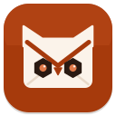

# Ferrowl

A fast desktop email client written in Rust, with a native UI built on [iced](https://iced.rs).



## Features

- **IMAP + SMTP** accounts (IMAP over TLS on 993; SMTP on 465 TLS or 587 STARTTLS), pure-Rust TLS (rustls)
- Three-pane window: folders · message list · reader
- Special folders detected automatically (Inbox, Sent, Drafts, Archive, Spam, Trash), unread counters, collapsible tree for all other folders
- List filters (All / Unread / Attachments) and search with `from:`, `has:attachment`, `is:unread`
- Reply, forward (with original attachments), archive, mark as unread
- **Delete moves to Trash**; deleting inside Trash asks for confirmation and removes the message for good
- Sent messages are saved to the Sent folder
- Compose with Cc/Bcc and file attachments
- Attachments saved to the Downloads folder with one click
- DKIM badge when the server reports `dkim=pass`
- **6 color themes** (Ruggine, Ardesia, Bosco, Lavanda, Sabbia, Notte) defined in [`design/themes.json`](design/themes.json)
- **10 languages**: English, Italiano, Français, Deutsch, Español, Português, 中文, 日本語, 한국어, العربية (right-to-left layout). The system language is used by default, falling back to English.
- Keyboard shortcuts: `C` compose · `R` reply · `F` forward · `E` archive · `U` mark unread · `J`/`K` or ↓/↑ next/previous · `Del` delete · `Ctrl K` or `/` search · `Ctrl Enter` send · `Esc` close
- Auto-refresh every 2 minutes

## Download

Prebuilt binaries for Linux (x86_64), Windows (x86_64) and macOS (Apple Silicon) are attached to each [release](https://github.com/creativalab/client-mail/releases).

The binaries are not signed yet:
- **macOS**: right-click → Open, or `xattr -d com.apple.quarantine ferrowl`
- **Windows**: SmartScreen → "More info" → "Run anyway"

## Build from source

```bash
cargo run --release
```

Requires Rust 1.85+ (edition 2024). On Linux no extra system packages are needed besides a graphics driver; the app runs on Wayland and X11.

## Configuration

On first launch Ferrowl opens the account setup. Settings are stored in:

| OS | Path |
|---|---|
| Linux | `~/.config/ferrowl/config.toml` |
| macOS | `~/Library/Application Support/ferrowl/config.toml` |
| Windows | `%APPDATA%\ferrowl\config.toml` |

The password is currently stored in this file (permissions `600` on Linux/macOS). Moving it to the system keychain is on the roadmap.

For Gmail, use an [app password](https://support.google.com/accounts/answer/185833).

## Translations

UI strings live in [`locales/`](locales/), one TOML file per language. `locales/en.toml` is the reference: every other file must contain the same keys with the same `{placeholders}` — `cargo test` checks this.

To add a language: copy `en.toml`, translate it, and register it in `LANGS` in [`src/i18n.rs`](src/i18n.rs).

## Development

```bash
cargo test                                   # unit tests (themes, locales, IMAP helpers)
cargo test -- --ignored                      # network tests (TLS handshake with imap.gmail.com)
cargo test live_account -- --ignored --nocapture   # uses the configured account
```

Environment variables useful during development:

| Variable | Effect |
|---|---|
| `FERROWL_LANG=ar` | Force a UI language for this run |
| `FERROWL_THEME=notte` | Force a theme for this run |
| `FERROWL_DEV_VIEW=settings\|appearance\|general\|compose\|popover` | Open a view directly |
| `FERROWL_SCREENSHOT=out.png` | Capture the window after `FERROWL_SCREENSHOT_DELAY` seconds (default 8) and quit |
| `FERROWL_SCREENSHOT_OPEN=1` | Open the first message before capturing |

The design handoff (mockups, tokens, icon) is in [`design/`](design/).

## Roadmap

- Password in the system keychain
- Local cache (SQLite) and full-text search (tantivy)
- HTML rendering (sanitized, remote images blocked by default)
- IMAP IDLE (push), notifications, tray icon
- OpenPGP signing/encryption
- Multiple accounts, JMAP

## Support

Problems or questions: **support@ferrowl.com**

## License

[MIT](LICENSE). Bundled fonts: Inter, JetBrains Mono and Noto Sans Arabic, all under the SIL Open Font License (see `assets/fonts/`).
